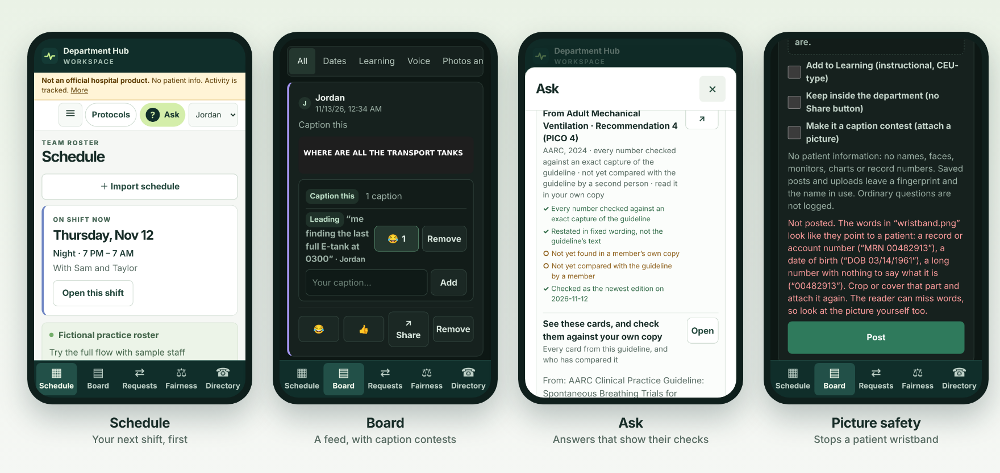

# Department Hub

A phone-first app for one hospital respiratory therapy department: the schedule, a department board people actually want to scroll, and reference answers that show exactly how far they have been checked. Built by a working respiratory therapist, solo, with AI assistance.

**[Open the fictional demo →](https://swixixle.github.io/department-hub/)**



> Not an official hospital product. No patient information belongs in it, and activity is tracked. The one exception is the Handoff tab, which keeps a shift report on the writer's own phone only (below). Every name, schedule and picture in this repository and the demo is invented.

## Why it exists

A hospital department runs on a paper schedule photographed into a group chat, policies buried three folders deep, and shift trades negotiated by text. Department Hub puts those in one place on the phone people already carry. It is being built for my own department first, and is meant to stay small: one department, its own members, nothing else.

## What it does

**Schedule from screenshots.** Drop in photos of the printed or on-screen schedule and the app reads them in the browser with Tesseract OCR: date rows, employee grids, and a photographed paper calendar with pink and green highlighter for charge and ICU. Every cell can be traced back to the spot on the photo it came from, and anything uncertain is flagged rather than guessed. The home screen leads with your next shift.

**Trades and coverage.** Tap one of your shifts to find who could take it, which swaps work, and which three-person exchanges keep everyone's weekly hours intact under the department's rules. Each option states what it does to everyone's hours. Agreements end at "queued for review"; nothing edits the official roster.

**A board worth opening.** An endless newest-first feed with pictures, video, voice messages, reactions, caption contests and a Learning tag for CEU-type posts. New posts wait behind a pill instead of shoving the page around. Posts written with no signal wait in an outbox and send when the phone reconnects.

**Picture safety.** Before a picture is posted, its location and camera data are stripped by re-encoding it, and the text in it is read. A picture showing a record number, a date of birth or a patient name is refused, with the words that set it off quoted back. The screen says plainly that the reader can miss words.

**Ask, with no language model.** One box answers "when do I work next", "who's on Saturday night", "who has more weekend shifts than Casey", and reference questions such as "should I turn up FiO2 during an SBT". It runs on question patterns and text matching. Every answer says how it read the question and opens its source. Nothing is sent to an AI service.

**Reference cards that show their checks.** Answers drawn from published guidelines list each check separately: every number verified against an exact capture of the source, every word of the card found in the passage it restates (with any "not" kept), wording restated rather than copied, and when the source was last confirmed as the newest edition. A member can also check the cards against their own copy of the guideline; that is listed when someone has. Each card set has a fingerprint published in [docs/CARD-FINGERPRINTS.md](docs/CARD-FINGERPRINTS.md), so anyone can see whether the cards changed.

**Fairness without ratings.** A kept record of weekends, holidays, charge and ICU turns, trades and low-census releases. Everyone sees their own sheet; the record keeper sees who is carrying more than their share. Nothing rates a person, and sick calls are never counted.

**Handoff, kept on the phone.** A therapist's report for the oncoming therapist: bed by bed, typed, dictated, or read from a photo of the vent screen or chart. It lives only on that phone, in its own storage, never sent, never backed up and never on the server, and it is wiped 13 hours after it starts or when its writer taps *Handed off*. Names, record numbers and birth dates are stopped as they are typed. Chart photos are blacked out by keeping only clinical words and short numbers, so a name is covered whether or not anything recognised it. Dictation runs a speech model on the phone itself (Whisper, downloaded once, about 77 MB); audio never leaves it. A bed-number handoff is still patient information, and [docs/HANDOFF.md](docs/HANDOFF.md) says so and says what that means.

**Passkey accounts.** On the shared server, members join with a personal invitation and a six-character code read aloud, then sign in with Face ID, a fingerprint or the phone's PIN. There is no password and no email typed at sign-in.

## Status

Honest about what is real and what is not:

| Part | State |
| --- | --- |
| Schedule import, trades, fairness, directory, Ask, protocols | Working, kept in one browser on one device |
| Board, reactions, caption contests, outbox, picture safety | Working; shared between phones when the server is running |
| Server with passkey accounts, invitations and approvals | Built and tested, including a two-phone run with virtual authenticators; not deployed |
| Schedule, fairness, directory and trades on the server | Tables, read routes and access rules built and tested by the access gate; the app does not use them yet, and there is no way yet to publish an imported schedule to the server |
| Protocols on the server | Not built |
| Handoff | Working on one phone, by design never shared; tested in Chromium with a synthetic voice, not yet on a real phone |
| Hosting | Planned on Fly.io (about $4–5 a month); [docs/DEPLOY.md](docs/DEPLOY.md) |
| Sign-in on a real phone | Not yet tried |
| Official roster integration, app-sent email or texts | Not built, and not authorized |

## What lives where

The plan, once the server is running. Most of it is not wired up yet (see Status).

| Kind | Where | Why |
| --- | --- | --- |
| The schedule, trades and their agreements | Shared, on the department's server | Everyone needs the same roster, and the fairness record is built from it |
| Fairness record | Shared, with access rules: each person sees their own sheet, the record keeper sees everyone's | It is staff information about named people, so it is held to who may see it, not made public |
| Directory | Shared; each member chooses whether their phone number is shown | Contact numbers are personal; sharing defaults off |
| Protocols and reference cards | Shared | Everyone answers from the same version |
| Board posts, reactions, captions | Shared | It is the department's feed |
| Schedule photos used for import | On the importing phone only | Only what was read from them is published |
| Handoff notes and photos | On the writer's phone only, wiped each shift | Patient information never goes to the server |

The server holds staff names, shifts, phone numbers members choose to share, and fairness records. That is not patient information, but it is personal information about coworkers, which is why the server has per-person accounts, department isolation, per-record access rules and receipts for named exports. A server here is one small computer that answers the phones when they ask. If it is off, the phones cannot reach each other, but each still runs everything that lives on it, and posts written meanwhile wait in the outbox.

## Try it

The [demo](https://swixixle.github.io/department-hub/) runs entirely in your browser with fictional staff. Choose **Import schedule**, then **Read 10 sample screenshots**, review what it read, and publish. Tap one of your shifts to start a trade. **Viewing as** lets you play the coworker on the other end. Everything you do stays in that browser.

To run it locally:

```sh
npm ci
npm run dev                          # the app alone, everything in the browser
```

With the shared server, which serves the app and the board together on one address:

```sh
npm run build
npm run server -- --static dist      # http://127.0.0.1:18080
node server/bootstrap.mjs --db ./local-data/hub.sqlite --department elm --department-name "Elm Respiratory" --name "Avery"
```

The last command creates the department's first administrator and prints a one-time token for their first passkey. Everyone after that is invited from inside the app.

Node 22 or newer is required; CI uses Node 24.

## How it is built

Vanilla JavaScript and CSS built with Vite, with no front-end framework. OCR is Tesseract.js, bundled and run in a browser worker, so schedule photos are read on the device and never uploaded. PDFs render with pdf.js. The server is plain Node with its built-in SQLite and SimpleWebAuthn for passkeys, packaged as one Docker image.

Records the app makes are hash-linked receipts, and each build carries a SHA-256 fingerprint of its own files in the footer, so a receipt says which exact build made it. These are tamper-evident, not tamper-proof: a local owner can replace a whole history, and the docs say so.

## How it is tested

The test suite is meant to try to break things, not to show they work:

- 284 unit tests (`npm test`) and 82 server tests (`npm run test:server`).
- An access-boundary gate (`npm run gate:shared`) that starts the real server against fresh synthetic accounts and checks department isolation, private conversations and immediate revocation.
- A fault-injection gate (`npm run gate:protocols`) that breaks the protocol code one way at a time in a throwaway copy and requires the matching test to fail.
- Interface checks against the production bundle in jsdom, and Playwright walks in real Chromium at phone size: two phones signing in with virtual passkey authenticators, and the Handoff tab with an invented chart photo (the name, record and birth-date regions measured black), an invented vent screen, a recorded voice through the on-phone speech model, and the 13-hour wipe.
- An evaluation set of Ask questions (`npm run eval:ask`) scored as correct, useful clarification, non-answer or confidently wrong. I wrote both the questions and the engine, so the score flatters it; real coworker questions are the test that counts.

CI runs the unit tests, the Ask evaluation, both builds, a build-fingerprint check and the interface checks on every pull request.

## Repository map

```
src/            the app: main.js (screens), importer.js (OCR), trades.js, fairness.js, ask.js,
                guidelines.js and facts.js (reference cards), picture-safety.js, shared.js,
                handoff*.js and whisper-worker.js (the Handoff tab)
server/         the shared server: passkeys, invitations, board, visibility rules
tests/          node:test suites; tests/server for the server
scripts/        build checks, gates, UI walks, the local installer and deploy script
docs/           decisions, design notes and reports; start with DIRECTION.md
```

Longer notes: [what each feature does in detail](docs/FEATURE-NOTES.md), [handoff](docs/HANDOFF.md), [guideline cards](docs/GUIDELINE-CARDS.md), [product direction](docs/DIRECTION.md), [sign-in design](docs/SIGN-IN.md), [server plan](docs/SERVER.md), [protocols](docs/PROTOCOLS.md).

## Privacy rules the code keeps

Real hospital documents, employer screenshots, staff data and credentials stay out of Git, test fixtures, CI artifacts and the public demo. The demo build cannot open local files. Phone numbers stay on the device unless a member chooses to share them. A text screen stops writing that points to a particular patient, and picture safety does the same for images. Neither catches everything, and both say so on screen. Handoff notes never leave the phone they were written on.

## License

No license has been chosen yet, so the code is all rights reserved by default. Ask before reusing it.
